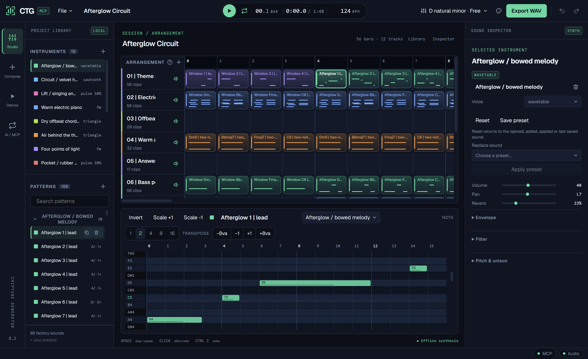

# CTG — ChipTuneGenerator MCP

A native chiptune workstation for people and AI agents. Write a melody, shape a
synth, arrange a song, or invite an MCP-compatible AI to compose in the same session.

[Download Windows](https://github.com/ahmetdenizyilmaz/CTG/releases/latest) ·
[User guide](docs/CTG-Studio-guide.txt) · [Demo songs](examples/README.md)



## The studio

- A slate/emerald workstation with a navigation rail, project library, arrangement
  and piano-roll editors, and a dedicated sound inspector. Visual direction inspired
  by the user's PixelForge app; CTG has its own mark and music-focused layout.
- **168 factory instruments:** the existing chip, FM, orchestral and custom packs,
  58 ZzFX sounds, and 24 original-song instruments. Edit synthesis, envelopes, filters, vibrato, unison and reverb.
- **Reset and Save preset:** restore a sound or keep it in your reusable local library.
- **Composition lab:** seeded 16/32/48-bar arrangements with rhythmic hooks, answering
  phrases, melodic look-ahead, spacious bridges, developed finales and recurring bass/drum grooves.
  [Composer v3 details and research](docs/composer-v3.txt).
- **Demo library:** 25 editable songs, including Neon Pixel Funk, Gravity Glissando, Pixel Sunrise, First Light and Clash of Banners. Original mastered previews are retained.
- **ZzFX import:** open Studio `.zzfx`, literal `.js`, or `song.json`; save an editable `.sbproj`. Full procedural synthesis and tracker effects run inside CTG.
- **Note expression:** click a note to edit slides, stepped glissando, velocity, held tails and ZzFX effects. Compose has a Neon Pixel Funk recipe for E-Dorian octave-bass funk with a reflective bridge.
- Undo/redo, native `.sbproj` projects, offline stereo WAV rendering, and a CLI.

The composer uses musical heuristics, not an AI model. Connected AI agents can
instead author every note through the low-level MCP tools. No cloud music service
or language-model subscription is included in CTG.

## Run

Download and extract the Windows release. Open **ctg-desktop.exe**. The package
also includes **ctg.exe**, projects, audio demos, licenses and the guide.
Microsoft Edge WebView2 is required (normally present on Windows 10/11).

Use **Demos** to open a project, **Studio** to edit, **Compose** for the composition
lab, and **AI / MCP** to connect an agent. Music and agent exports live in
`~/Music/CTG`; saved sounds live in `~/Music/CTG/presets`.

## Connect an AI

While the desktop is open, connect your client's streamable HTTP MCP transport to:

```text
http://127.0.0.1:7414/mcp
```

For clients accepting this configuration shape:

```json
{"mcpServers":{"ctg":{"type":"http","url":"http://127.0.0.1:7414/mcp"}}}
```

Or start an isolated headless session over stdio:

```sh
ctg mcp --root ./songs
```

There are **37 tools** for instruments, notes, patterns, arrangement, files,
composition, sound design and history. An intentional composition workflow is:

```text
reference_get → song_new → instrument_add_preset → pattern_create
→ track_add → arrangement_place_many → song_save → export_wav
```

The optional rule-based workflow is `composition_random` / `composition_defaults`
→ `composition_preview` → `song_get` → `song_compose`. The final call checks the
expected editor ID and revision before replacing the song. AI edits are visible
in the desktop and undoable. `CTG_MCP_PORT` selects another HTTP port.

## Listen to an AI-authored example

**Afterglow Circuit** is a 1:50 emotional/funk instrumental with 15 instruments and
12 tracks. An AI sub-agent wrote the melody, chords, bass and arrangement through
**325 native MCP calls, with no random-song or song_compose calls**. The native
project, WAV, score script and audit are in [examples/afterglow-circuit](examples/afterglow-circuit).
Technical checks cover score validity and audio levels; musical taste remains a
listening judgment. [Three new generated previews](examples/composer-v3) demonstrate
composer v3, with editable projects and reproducible recipes. Earlier featured
examples retain their v2 arrangements. The library also preserves earlier
Antigravity, Claude and Codex sessions.

## Build and verify

Requires Rust stable, Node.js 22+, and Tauri's native platform prerequisites.

```sh
cd apps/desktop
npm ci
npm run check
npm run lint
npm test
npm run tauri -- build --no-bundle
cd ../..
cargo build --release -p soundbit-cli
cargo test --workspace
cargo clippy --workspace --all-targets -- -D warnings
cargo xtask check
python scripts/package-windows.py
```

CLI examples:

```sh
ctg compose-config
ctg compose --config recipe.json -o song.sbproj --wav song.wav
ctg play song.sbproj
ctg render song.sbproj -o song.wav
```

`website/` contains the static product site and demo player. Serve it with
`python -m http.server --directory website 8080`.

## License and provenance

GPL-3.0-or-later. CTG is a separately branded app and repository, built on the
SoundBit audio/editing foundation by Renas Demirbas and ahmetdenizyilmaz/SoundBit.
The compatible project format and internal engine crate names are retained.
ZzFX Studio composition ideas are credited under MIT. Fonts and other references
are documented in [THIRD_PARTY_NOTICES.md](THIRD_PARTY_NOTICES.md).

## ZzFX compatibility

See [import and expression details](docs/zzfx-compatibility.txt). Imports never execute
JavaScript. Mastering applied outside the source project is not recreated; the
original demo recordings remain available for comparison.
